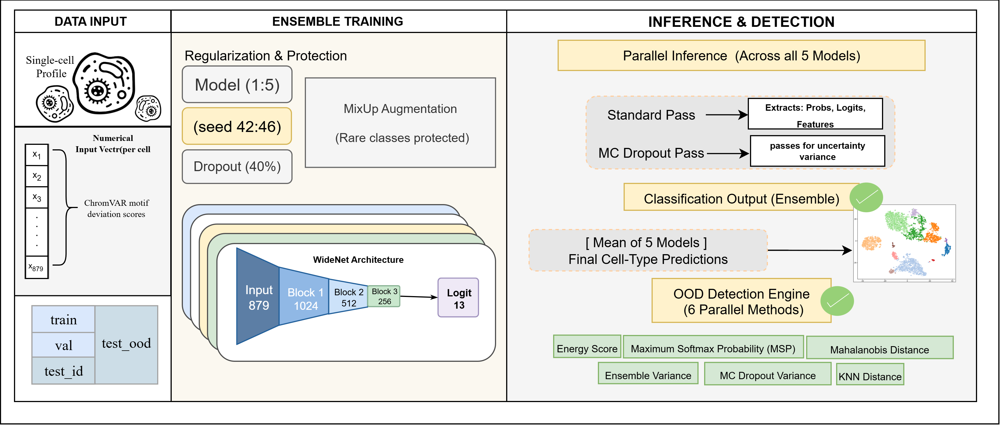

<div align="center">
<p align="center">
  
  <h1 align="right">scAURA</h1>
</p>
# scAURA


### Single-Cell ATAC-seq Unified Regulatory Analysis

*Cell-type annotation and out-of-distribution detection for scATAC-seq data*  
*using chromatin accessibility–derived transcription factor motif signatures*

<br>

[](https://python.org)
[](https://pytorch.org)
[](https://scikit-learn.org)
[](LICENSE)

<br>

| Metric | Value |
|--------|-------|
|  Ensemble Accuracy | **87.75%** |
|  Balanced Accuracy | **86.02%** |
|  Macro F1 | **86.22%** |
|  Best OOD AUROC | **0.8787** (KNN) |
|  Cell Types | **13 PBMC lineages** |
|  Training Time | **23.1 min** (5 models, GPU) |

</div>

---

## Overview

**scAURA** is a deep learning framework for **supervised immune cell-type annotation** and **out-of-distribution (OOD) detection** in single-cell ATAC-seq data.

Rather than operating on the raw, dataset-specific peak matrix, scAURA uses **ChromVAR transcription factor motif deviation scores** as input — a compact, biologically interpretable, and cross-dataset-compatible feature representation derived from the JASPAR 2024 CORE database (879 vertebrate motifs). This design enables the model to classify known immune populations while simultaneously flagging novel or aberrant cell types that were never seen during training.

**Key capabilities:**

- Multi-class immune cell classification across 13 PBMC lineages
- Out-of-distribution detection via 6 complementary uncertainty methods
- Ensemble of 5 independent WideNet models for robust, calibrated predictions
- Full reproducibility — fixed seeds, saved checkpoints, and split indices
- End-to-end pipeline from raw `.h5ad` to trained model and OOD scores

---

## Architecture

scAURA is built on a **5-model deep ensemble** of WideNet feed-forward networks. Each model is trained independently from a different random seed, and their probability outputs are averaged at inference time.


<p align="center">
  
</p>

---

## Results

### Classification Performance — Test Set (n = 3,894 cells)

| Metric | Score |
|--------|-------|
| **Accuracy** | **87.75%** |
| **Balanced Accuracy** | **86.02%** |
| **Macro F1** | **86.22%** |
| **Weighted F1** | **87.60%** |
| **Cohen's κ** | **0.8606** |

---

## Dataset

scAURA was developed and evaluated on the **healthy adult human PBMC scATAC-seq atlas** ([GSE184462](https://www.ncbi.nlm.nih.gov/geo/query/acc.cgi?acc=GSE184462)).

| Split | Cells | Description |
|-------|-------|-------------|
| Train | 31,147 | Stratified 80% of 13 ID types |
| Validation | 3,893 | Stratified 10% of 13 ID types |
| Test (ID) | 3,894 | Stratified 10% of 13 ID types |
| Test (OOD) | 415 | Plasma cells — held out entirely |
| **Total** | **39,349** | |

Each cell is represented by an **879-dimensional vector** of ChromVAR bias-corrected TF motif deviation scores, derived from the [JASPAR 2024 CORE vertebrates](https://jaspar.elixir.no) non-redundant database.

---

## Installation
### Environment Specifications

| Package | Installed Version | Minimum Required |
| :--- | :--- | :--- |
| **numpy** | 1.26.4 | 1.21.0 |
| **pandas** | 2.3.3 | 1.3.0 |
| **scipy** | 1.15.3 | 1.7.0 |
| **torch** | 2.12.0.dev20260407 | - |
| **scikit-learn** | 1.7.2 | 1.0.0 |
| **scanpy** | 1.11.5 | 1.9.0 |
| **anndata** | 0.11.4 | 0.9.0 |
| **pyfaidx** | 0.9.0.3 | 0.7.0 |
| **requests** | 2.32.5 | 2.26.0 |
| **tqdm** | 4.67.1 | 4.60.0 |
| **matplotlib** | 3.10.8 | 3.4.0 |
| **seaborn** | 0.13.2 | 0.11.0 |
| **MOODS-python** | Installed | 1.9.4 |

## Usage

### Step 1 — Preprocessing

Run the four preprocessing scripts in order. Each step checkpoints its output — interrupted runs resume automatically from where they stopped.

```bash
# 1. Peak extraction, genome + JASPAR download, motif scanning
python preprocessing/part1.py

# 2. ChromVAR bias-corrected deviations  (GPU recommended)
python preprocessing/part2.py

# 3. Assemble the 879-motif feature matrix
python preprocessing/Part3.py

# 4. Create train / val / test / OOD splits
python preprocessing/Part4.py
```

> ⚠️ Before running, update the base directory paths at the top of each script to match your environment.

For HPC clusters, motif scanning in Step 1 can be parallelized across chunks:

```bash
# Run chunks in parallel (adjust --n-chunks as needed)
python preprocessing/part1.py --chunk 0 --chunk-size 50000
python preprocessing/part1.py --chunk 1 --chunk-size 50000
python preprocessing/part1.py --chunk 2 --chunk-size 50000
python preprocessing/part1.py --chunk 3 --chunk-size 50000

# Then merge and build the motif-peak matrix
python preprocessing/part1.py --merge --n-chunks 4
```

---

### Step 2 — Train the Ensemble

```bash
python model/Model7_ensemble_.py
```

**Optional arguments** (all defaults match the published configuration):

```bash
python model/Model7_ensemble_.py \
    --epochs       150         \
    --batch        256         \
    --lr           1e-3        \
    --dropout      0.4         \
    --label-smooth 0.1         \
    --mixup-alpha  0.2         \
    --mc-passes    30          \
    --patience     40          \
    --seeds  42 43 44 45 46
```
The script trains all 5 models sequentially, then runs full ensemble inference and evaluates all 6 OOD detection methods automatically. Checkpoints, metrics, and figures are saved to `stage_e_model7_fixed/`.

---

<div align="center">


</div>
